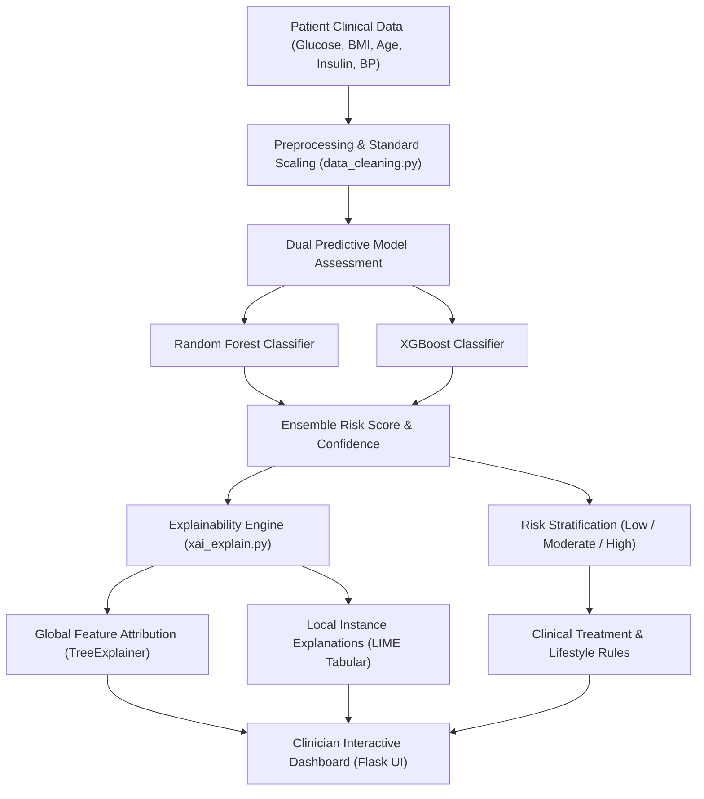

# Explainable Clinical Decision Support System (XAI-CDSS) for Diabetes Risk Assessment


XAI-CDSS is an interpretable clinical decision support system designed to assist healthcare providers in predicting patient diabetes risk while exposing the underlying mathematical rationale behind every prediction through local and global Explainable AI (XAI) frameworks.

---

## 🏛️ System Architecture & Inference Flow



---

## 🔬 Core Engineering & Explainability

1. **Dual Machine Learning Ensemble:** Evaluates patient metrics across both **Random Forest** and **XGBoost** models to capture non-linear relationships and avoid single-model variance (`train_models.py`, `risk_assessment.py`).
2. **Global Interpretability with SHAP:** Implements `shap.TreeExplainer` to compute exact Shapley values across the feature space, establishing overall feature importance rankings (identifying Fasting Glucose and BMI as primary risk drivers).
3. **Local Interpretability with LIME:** Generates patient-specific perturbation explanations (`LimeTabularExplainer`), visually displaying which individual biomarker pushed the score toward positive or negative diagnosis.
4. **Clinical Decision Guardrails:** Maps predicted risk scores to evidence-based lifestyle recommendations, symptom cross-referencing, and medical warnings (`treatment_recommendation.py`, `symptom_search.py`).

---

## 📁 Repository Structure

```
Diabetes_detection/
├── app.py                         # Flask application & route controller
├── data_cleaning.py               # Imputation, outlier handling, and feature scaling
├── risk_assessment.py             # Model inference & probability scoring
├── train_models.py                # Training pipeline for Random Forest and XGBoost
├── treatment_recommendation.py    # Rule-based clinical recommendation mapper
├── symptom_search.py              # Symptom ontology search utility
└── xai_explain.py                 # SHAP and LIME visualization generation
```

---

## 🚀 Quickstart & Setup

### 1. Clone & Initialize Environment
```bash
git clone https://github.com/sultanriaz/Diabetes_detection.git
cd Diabetes_detection
python -m venv venv
# Linux / macOS:
source venv/bin/activate
# Windows:
.\venv\Scripts\Activate.ps1
```

### 2. Install Required Dependencies
```bash
pip install flask scikit-learn xgboost shap lime pandas numpy matplotlib
```

### 3. Launch the Application
```bash
python app.py
```
Open [http://127.0.0.1:5000](http://127.0.0.1:5000) in your browser to interact with the clinician dashboard.
